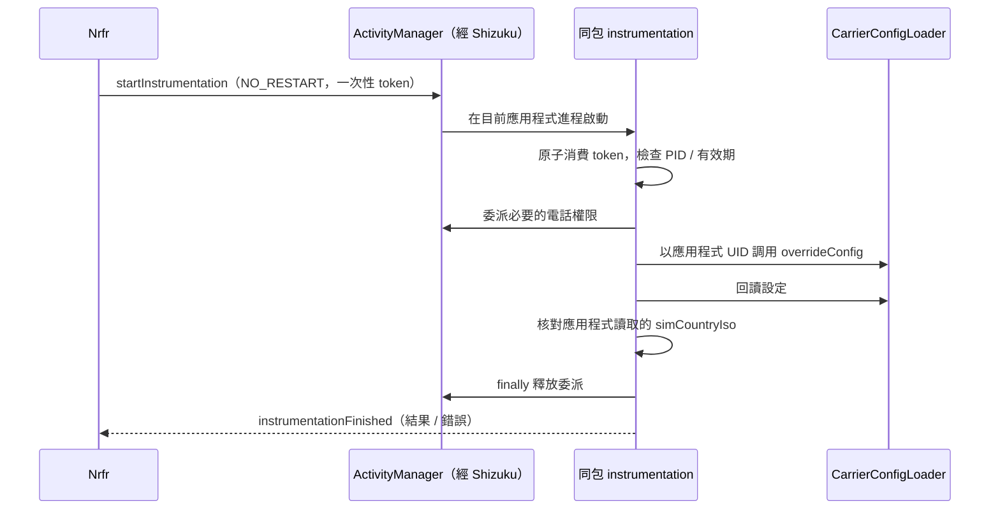

# Android 17 / Shizuku 相容修復

## 原因與依據

原版直接把 `carrier_config` Binder 包裝成 `ShizukuBinderWrapper`，再調用
`ICarrierConfigLoader.overrideConfig(subId, values, true)`。這樣服務端看到的調用 UID 是 shell。
部分較新系統會拒絕這個 UID，即使 shell 已有 `MODIFY_PHONE_STATE` 權限，仍會報
`overrideConfig cannot be invoked by shell`。這不是重新授權或升級 targetSdk 就能解決的問題。

已有對應的 [Nrfr Android 17 問題報告](https://github.com/Ackites/Nrfr/issues/139)。
[carrier-ims-for-pixel 的 ImsModifier](https://github.com/ryfineZ/carrier-ims-for-pixel/blob/e9035ac/app/src/main/java/io/github/vvb2060/ims/privileged/ImsModifier.kt)
使用 instrumentation 與 shell 權限委派，在保留應用程式調用身份的情況下寫入。
不同廠商和 build 的限制不同，不能據此斷言所有 Android 17 都使用完全相同的檢查。

## 調用鏈



寫入權限只包含 `MODIFY_PHONE_STATE` 與回讀、校驗訂閱需要的 `READ_PHONE_STATE` /
`READ_PRIVILEGED_PHONE_STATE`；讀取操作不委派修改權限。設定載荷保留在進程內，啟動參數只有隨機 token 與 PID。
未知、重復、過期或不屬於目前進程的請求不會取得委派權限。請求串行執行；逾時不會報告成功，也不會立刻啟動重疊的委派。
這些 token 限制是實現上的約束，不是針對同 UID 惡意代碼的安全邊界。

Android 10+ 使用上述路徑。Android 8 / 9 保留直接通過 Shizuku 調用的相容路徑。
國家碼覆寫項是否被系統採用取決於平臺實現；寫入成功與第三方應用程式認可該地區是不同的結果。

## 持久性與還原

Android 16 / 17 優先使用 `persistent=false`，避免普通應用程式的持久寫入被拒絕或看似成功卻不生效。
較早系統保留持久寫入。只有明確指向持久權限限制的 `SecurityException` 才回退到非持久寫入；其他錯誤直接返回。
設定非空時等待最多 5 秒，確認指定鍵與系統實際報告的 SIM ISO 一致。

還原先使用 `null` 設定嘗試同時清除暫時和舊的持久覆寫；如果系統只允許非持久調用，則清除暫時覆寫並提示重新啟動後確認。
還原可能清除其他工具對同一 SIM 的覆寫，應在重新使用 IMS 工具前核對其設定。
本改版不添加自動啟動或後臺重新套用功能。

## 構建驗證

使用 JDK 17+、Android SDK Platform 37.2、Build Tools 37.0.0 和 Gradle 9.6.0，在根目錄執行：

```sh
./gradlew :app:testDebugUnitTest :app:lintDebug :app:assembleDebug :app:assembleRelease
```

`hidden-api` 模塊僅提供編譯籤名；`compileOnly` 保證裝置上的框架類處理真實 Binder 協議。
不需要下載完整隱藏 API `android.jar`，也不會把這些 `android.*` 樁類放進應用程式 dex。
新增單元測試覆寫 Android 16 / 17 寫入策略、還原與受限回退，以及 token 過期、重放、跨進程和並發消費。

編譯使用官方最新可用的非 beta 平臺包 `platforms;android-37.2`；targetSdk 為 37。
AGP 9.4.1 與 Gradle 9.6.0 配套，採用 AGP 內置 Kotlin 2.2.10 與相同版本的 Compose 編譯插件。
設定依據：[Android 17 SDK](https://developer.android.com/about/versions/17/setup-sdk)、
[AGP 9.4 相容性](https://developer.android.com/build/releases/agp-9-4-0-release-notes)、
[內置 Kotlin 遷移](https://developer.android.com/build/migrate-to-built-in-kotlin)。

## 真機驗證

1. 安裝構建的 APK，啟動 Shizuku 並授權 Nrfr。不同籤名的 APK 不能直接覆寫舊版；如安裝器提示籤名衝突，需要先卸載舊版再安裝。
2. 確認實體 SIM / eSIM 列表、SIM 槽位及目前設定正確。
3. 選擇目標 SIM，設定例如 `US` 與一個電信業者名稱。成功後目前設定應顯示 `us` 和所選名稱。
4. 如果顯示回讀不一致，記錄手機型號、完整系統 build 與錯誤文字；此時不能視為已成功套用。
5. 雙 SIM 時核對另一個 SIM 沒有被誤改，再測試其獨立設定。
6. 點擊還原並核對目前設定；重新啟動後檢查是否有舊的持久設定重新出現。
7. 重新啟動裝置重新啟動 Shizuku，核對非持久覆寫的生命周期；必要時手動重新套用。

可使用電腦執行 `adb logcat -s NrfrCarrierConfig` 取得本次操作的完整異常。
若回讀成功但目標應用程式行為未改變，再分別檢查該應用程式版本、緩存、賬號與網路條件。
