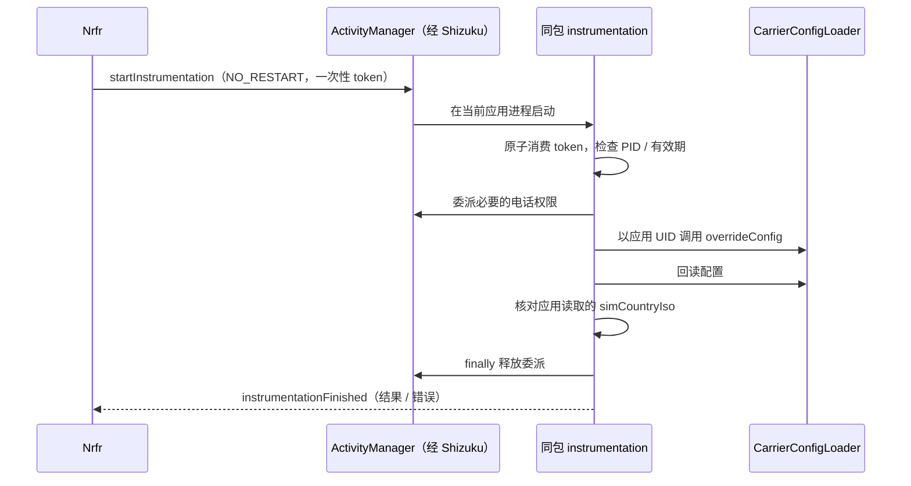

# Android 17 / Shizuku 兼容修复

## 原因与依据

原版直接把 `carrier_config` Binder 包装成 `ShizukuBinderWrapper`，再调用
`ICarrierConfigLoader.overrideConfig(subId, values, true)`。这样服务端看到的调用 UID 是 shell。
部分较新系统会拒绝这个 UID，即使 shell 已有 `MODIFY_PHONE_STATE` 权限，仍会报
`overrideConfig cannot be invoked by shell`。这不是重新授权或升级 targetSdk 就能解决的问题。

已有对应的 [Nrfr Android 17 问题报告](https://github.com/Ackites/Nrfr/issues/139)。
[carrier-ims-for-pixel 的 ImsModifier](https://github.com/ryfineZ/carrier-ims-for-pixel/blob/e9035ac/app/src/main/java/io/github/vvb2060/ims/privileged/ImsModifier.kt)
使用 instrumentation 与 shell 权限委派，在保留应用调用身份的情况下写入。
不同厂商和 build 的限制不同，不能据此断言所有 Android 17 都使用完全相同的检查。

## 调用链



写入权限只包含 `MODIFY_PHONE_STATE` 与回读、校验订阅需要的 `READ_PHONE_STATE` /
`READ_PRIVILEGED_PHONE_STATE`；读取操作不委派修改权限。配置载荷保留在进程内，启动参数只有随机 token 与 PID。
未知、重复、过期或不属于当前进程的请求不会取得委派权限。请求串行执行；超时不会报告成功，也不会立刻启动重叠的委派。
这些 token 限制是实现上的约束，不是针对同 UID 恶意代码的安全边界。

Android 10+ 使用上述路径。Android 8 / 9 保留直接通过 Shizuku 调用的兼容路径。
国家码覆盖项是否被系统采用取决于平台实现；写入成功与第三方应用认可该地区是不同的结果。

## 持久性与还原

Android 16 / 17 优先使用 `persistent=false`，避免普通应用的持久写入被拒绝或看似成功却不生效。
较早系统保留持久写入。只有明确指向持久权限限制的 `SecurityException` 才回退到非持久写入；其他错误直接返回。
设置非空时等待最多 5 秒，确认指定键与系统实际报告的 SIM ISO 一致。

还原先使用 `null` 配置尝试同时清除临时和旧的持久覆盖；如果系统只允许非持久调用，则清除临时覆盖并提示重启后确认。
还原可能清除其他工具对同一 SIM 的覆写，应在重新使用 IMS 工具前核对其配置。
本改版不添加自动启动或后台重新应用功能。

## 构建验证

使用 JDK 17+、Android SDK Platform 37.2、Build Tools 37.0.0 和 Gradle 9.6.0，在根目录执行：

```sh
./gradlew :app:testDebugUnitTest :app:lintDebug :app:assembleDebug :app:assembleRelease
```

`hidden-api` 模块仅提供编译签名；`compileOnly` 保证设备上的框架类处理真实 Binder 协议。
不需要下载完整隐藏 API `android.jar`，也不会把这些 `android.*` 桩类放进应用 dex。
新增单元测试覆盖 Android 16 / 17 写入策略、还原与受限回退，以及 token 过期、重放、跨进程和并发消费。

编译使用官方最新可用的非 beta 平台包 `platforms;android-37.2`；targetSdk 为 37。
AGP 9.4.1 与 Gradle 9.6.0 配套，采用 AGP 内置 Kotlin 2.2.10 与相同版本的 Compose 编译插件。
配置依据：[Android 17 SDK](https://developer.android.com/about/versions/17/setup-sdk)、
[AGP 9.4 兼容性](https://developer.android.com/build/releases/agp-9-4-0-release-notes)、
[内置 Kotlin 迁移](https://developer.android.com/build/migrate-to-built-in-kotlin)。

## 真机验证

本开发环境没有连接用户的 Android 17 手机，因此不把编译成功当作真机通过。验证方法：

1. 安装构建的 APK，启动 Shizuku 并授权 Nrfr。不同签名的 APK 不能直接覆盖旧版；如安装器提示签名冲突，需要先卸载旧版再安装。
2. 确认实体 SIM / eSIM 列表、SIM 槽位及当前配置正确。
3. 选择目标 SIM，设置例如 `US` 与一个运营商名称。成功后当前配置应显示 `us` 和所选名称。
4. 如果显示回读不一致，记录手机型号、完整系统 build 与错误文字；此时不能视为已成功套用。
5. 双 SIM 时核对另一个 SIM 没有被误改，再测试其独立配置。
6. 点击还原并核对当前配置；重启后检查是否有旧的持久配置重新出现。
7. 重启设备重新启动 Shizuku，核对非持久覆写的生命周期；必要时手动重新应用。

可使用电脑执行 `adb logcat -s NrfrCarrierConfig` 获取本次操作的完整异常。
若回读成功但目标应用行为未改变，再分别检查该应用版本、缓存、账号与网络条件。
